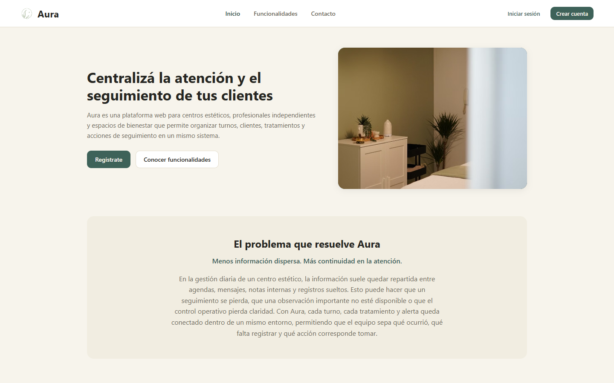
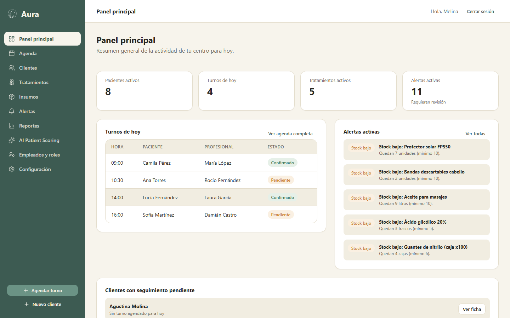
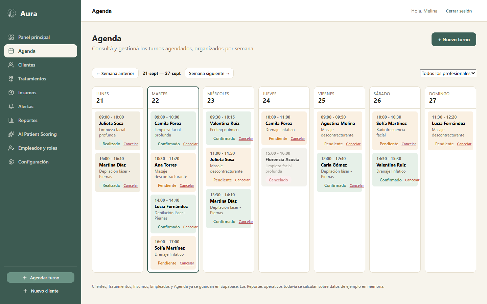
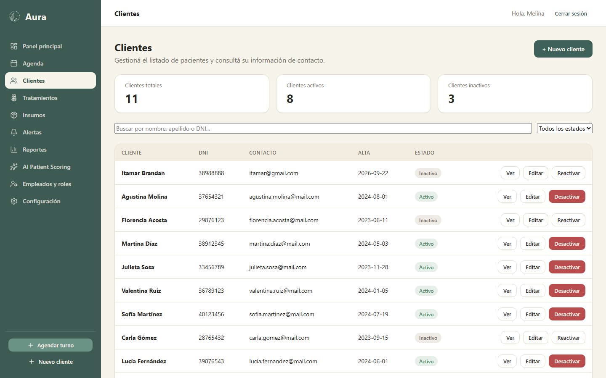
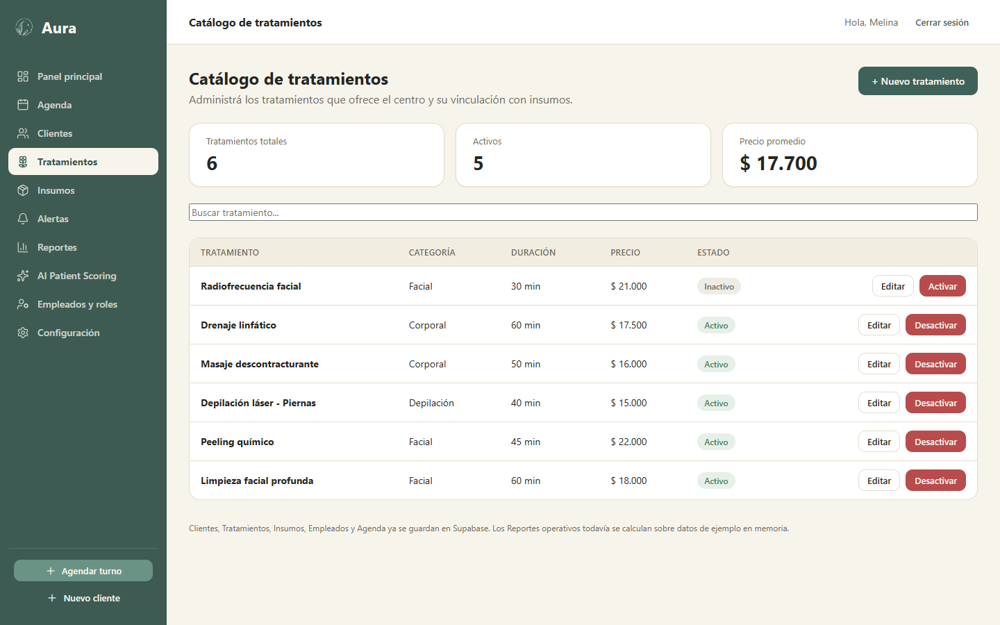
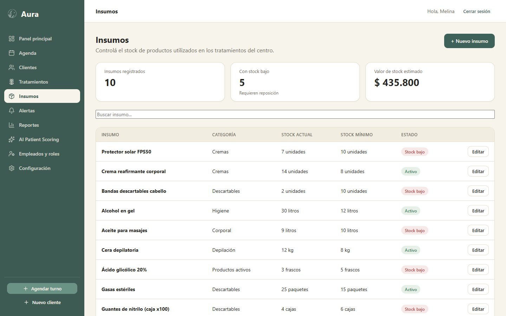
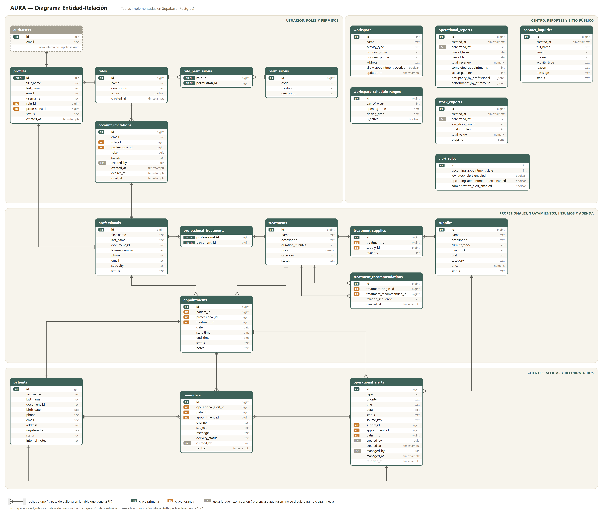

# Aura

**Gestión inteligente para bienestar y estética.**

Trabajo Final de Ingeniería — Universidad Abierta Interamericana.

Aura es una plataforma web para centros estéticos, profesionales independientes y espacios de bienestar. Centraliza la gestión de pacientes, profesionales, tratamientos, turnos e insumos, con alertas automáticas, recordatorios, reportes operativos y priorización de clientes con IA, todo en un mismo sistema.

## Capturas

| Landing | Panel principal |
|---|---|
|  |  |

| Agenda | Clientes |
|---|---|
|  |  |

| Tratamientos | Insumos |
|---|---|
|  |  |

## Stack tecnológico

- **Frontend**: React + Vite, React Router, SCSS
- **Backend**: [Supabase](https://supabase.com) — Postgres, autenticación, API REST autogenerada y una Edge Function para la IA
- **IA**: Google Gemini (tier gratis), llamado desde la Edge Function `patient-insight` para que la API key nunca llegue al navegador
- **PDF**: jsPDF, para exportar reportes y stock
- **Íconos**: [lucide-react](https://lucide.dev)
- **Publicación**: Vercel

No hay un backend propio corriendo aparte: Supabase cumple ese rol (base de datos, autenticación y API), y React se conecta directo a través de su cliente JS.

## Arquitectura

El proyecto mantiene una separación en capas dentro del propio cliente React, en vez de un servidor .NET/Node aparte:

```
Presentación (pages/ y components/)
        ↓
BLL — src/bll/*.js         (reglas de negocio: validaciones, superposición de turnos, cálculo de alertas)
        ↓
Mappers — src/mappers/*.js (traducen filas de la base a objetos de la app y viceversa)
        ↓
DAL — src/dal/*.js         (consultas puras a Supabase, sin lógica de negocio)
        ↓
Supabase (Postgres + Auth + Edge Functions)
```

Cada módulo (pacientes, tratamientos, insumos, turnos, etc.) tiene su propio archivo en cada capa, con el mismo nombre de funciones en todas partes — así ninguna pantalla necesita cambiar si el día de mañana cambia cómo se accede a los datos.

## Modelo de datos



El diagrama está también en [SVG](docs/der/der_aura.svg), para ampliarlo sin perder calidad.

## Seguridad: roles y permisos

Cada empleado tiene un rol (Administrador, Operador, Profesional o uno personalizado), y cada rol tiene permisos por módulo (`patients.view`, `schedule.manage`, `employees.manage`, etc.), editables desde **Empleados y roles → Roles y permisos**.

Los permisos se aplican en dos lugares:

- **En la interfaz**: el menú, las rutas y los botones de crear/editar se muestran según el rol.
- **En la base de datos**: las políticas RLS de Supabase llaman a la función `has_permission()`, así que aunque alguien manipule la app a mano, la base rechaza lo que su rol no permite. Desactivar a un empleado le corta el acceso a todos los datos, aunque tenga la sesión abierta.

Las cuentas nuevas entran con un **enlace de invitación** que define su rol. Quien se registra sin invitación queda inactivo hasta que un administrador lo aprueba.

## Estructura del proyecto

```
Aura/
├─ src/
│  ├─ pages/        → una carpeta por módulo (patients, treatments, supplies, schedule, ...)
│  ├─ components/   → piezas reutilizables (Sidebar, Topbar, Modal, Badge, Logo, ...)
│  ├─ layouts/       → PublicLayout (sitio público) y AppLayout (panel interno)
│  ├─ context/       → AuthContext (sesión real de Supabase Auth)
│  ├─ bll/           → lógica de negocio (una capa por entidad)
│  ├─ mappers/       → traducción de datos entre la base y la app
│  ├─ dal/           → acceso a datos (consultas a Supabase)
│  └─ styles/        → variables y estilos base compartidos
├─ supabase/         → scripts SQL (esquema, seguridad, datos de ejemplo) y la Edge Function de IA
├─ public/           → assets estáticos (logo, etc.)
└─ docs/screenshots/ → capturas usadas en este README
```

## Cómo levantarlo en otra PC

Como la base de datos vive en la nube (Supabase), no hace falta instalar ningún motor de base de datos local — solo Node.js y conexión a internet.

1. Cloná el repositorio:
   ```bash
   git clone https://github.com/melinatabor/Aura.git
   cd Aura
   ```
2. Creá un archivo `.env` en la raíz (no viaja en el repositorio, por seguridad) con las credenciales del proyecto de Supabase:
   ```
   VITE_SUPABASE_URL=https://xxxxxxxx.supabase.co
   VITE_SUPABASE_PUBLISHABLE_KEY=sb_publishable_xxxxxxxx
   ```
   Se consiguen en el dashboard de Supabase, en **Project Settings → API**.
3. Instalá las dependencias y corré el proyecto:
   ```bash
   npm install
   npm run dev
   ```
4. Abrí la URL que muestre la consola (por defecto `http://localhost:5173`).

También está publicada en Vercel, así que para una demo alcanza con abrir la URL desde cualquier navegador, sin instalar nada.

### Armar la base desde cero

Solo hace falta si se usa un proyecto de Supabase nuevo. Correr en el **SQL Editor**, en este orden:

| # | Script | Qué hace |
|---|---|---|
| 1 | `schema.sql` | Tablas principales, trigger de perfiles |
| 2 | `grants.sql` | Permisos de Postgres para los usuarios logueados |
| 3 | `schema_contact_inquiries.sql` | Consultas del formulario público |
| 4 | `schema_username.sql` | Login por nombre de usuario |
| 5 | `schema_week8.sql` | Reportes y exportaciones persistidas, recomendaciones |
| 6 | `schema_week9_to_11.sql` | Roles y permisos, invitaciones, alertas, recordatorios, datos del centro y políticas RLS por permiso |
| 7 | `seed.sql` y los `seed_*.sql` | Datos de ejemplo (opcionales) |

Para la IA: desplegar `supabase/functions/patient-insight` desde **Edge Functions** y cargar el secret `GEMINI_API_KEY` (se saca gratis en [Google AI Studio](https://aistudio.google.com/apikey)).

## Módulos

**Sitio público**: Home, Funcionalidades, Contacto (guarda la consulta en la base), Iniciar sesión, Crear cuenta.

**Panel interno (Aura Pro)**:

- **Panel principal**: turnos del día, alertas abiertas y clientes sin seguimiento.
- **Agenda**: vista semanal. Solo ofrece los profesionales que realizan el tratamiento elegido, calcula la hora de fin con la duración y valida el horario de atención y la superposición de turnos.
- **Clientes**: listado y ficha con historial, notas internas, puntaje de prioridad y tratamientos sugeridos según su historial.
- **Tratamientos**: catálogo con insumos vinculados y tratamientos recomendados en conjunto.
- **Insumos**: stock con exportación a PDF e historial.
- **Alertas**: stock bajo y turnos sin confirmar (se generan y se cierran solas), avisos administrativos, recordatorios por WhatsApp o mail con registro de envío.
- **Reportes operativos**: ingresos, ocupación por profesional, gráficos y exportación a PDF.
- **AI Patient Scoring**: puntaje explicable (recencia, frecuencia, confiabilidad) y recomendaciones redactadas por IA (Gemini).
- **Empleados y roles**: empleados, profesionales con sus tratamientos, matriz de roles y permisos, e invitaciones.
- **Configuración**: datos del centro, horarios de atención, reglas de agenda y de alertas.

## Estado del proyecto

Todos los módulos están conectados de punta a punta a Supabase, con roles y permisos aplicados también en la base de datos. El desarrollo siguió un plan de 13 semanas documentado aparte.

Quedó afuera a propósito el modo multi-tenant (varios centros en una misma instalación), que era opcional: Aura administra un solo centro.

## Autora

Melina Aldana Tabor — Ingeniería en Sistemas, UAI.
